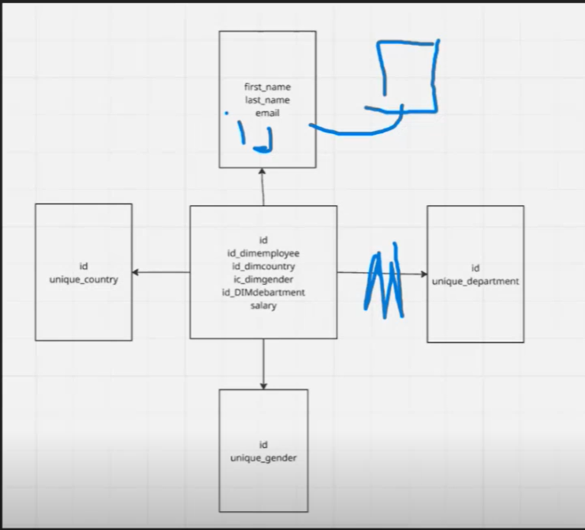

# DEPI Employee Data Warehouse — dbt + SQL Server

This repository contains the dbt project for the DEPI Employee Data Warehouse assignment.

> **Data-model note:** The dimensional schema implemented in this project follows the schema provided in the class session. The diagram below is the required schema for implementation; it is not presented as a new data model designed independently for this project.

## Required schema



The required model contains four dimensions — `DIMEmployee`, `DIMCountry`, `DIMDepartment`, and `DIMGender` — connected to `FactEmployee`. The fact table contains `id`, the four dimension keys, and `salary`.

## Project structure

```text
depi_employee_dbt/
├── models/
│   ├── staging/
│   │   ├── stg_employees.sql
│   │   ├── stg_DIMEmployee.sql
│   │   ├── stg_DIMCountry.sql
│   │   ├── stg_DIMDepartment.sql
│   │   ├── stg_DIMGender.sql
│   │   ├── OBT.sql
│   │   └── schema.yml
│   ├── dwh/
│   │   ├── DIMEmployee.sql
│   │   ├── DIMCountry.sql
│   │   ├── DIMDepartment.sql
│   │   ├── DIMGender.sql
│   │   ├── FactEmployee.sql
│   │   └── schema.yml
│   └── sources.yml
├── tests/
│   ├── staging/
│   └── dwh/
├── macros/
│   └── clean_string.sql
├── docs/
│   └── schema.png
├── dbt_project.yml
├── pyproject.toml
└── uv.lock
```

## Architecture

- **Staging:** contains the staging employee view, staging versions of the dimensions, and the One Big Table (`OBT`).
- **DWH:** contains copies of the dimensions built with dbt `ref()` and the `FactEmployee` table.
- **Tests:** contains singular SQL tests. A test passes when its query returns no rows.

## Requirements

- Python version supported by the `pyproject.toml` file
- `uv`
- SQL Server access to the source database/table configured in `models/sources.yml`
- A local dbt profile named `depi_dbt`

## Setup

Run these commands from the repository root:

```bash
uv sync
```

Configure the dbt profile locally at `~/.dbt/profiles.yml` (Windows: `%USERPROFILE%\.dbt\profiles.yml`). Do not commit credentials or passwords.

Then validate and run the project:

```bash
uv run dbt debug
uv run dbt run
uv run dbt test
```

The `employee_source` source in `models/sources.yml` currently points to database `DEPI_EmployeeDB`, schema `dbo`, table `datadbt1`. Update it only if your SQL Server source table uses a different location.

## Tests

The singular tests are SQL files under `tests/staging/` and `tests/dwh/`. They check dimension ID uniqueness and that fact-table keys resolve to the corresponding dimensions.

## Documentation

The project documentation can be generated with:

```bash
uv run dbt docs generate
uv run dbt docs serve
```
